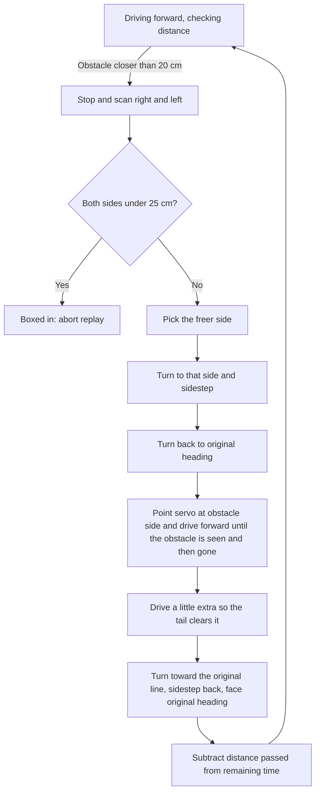

# Path Memorizing Robot Car with Obstacle Avoidance

An Arduino robot car that **learns a route from an IR remote, remembers it, and replays it on its own**. If an obstacle blocks the memorized path during replay, the car scans left and right with an ultrasonic sensor on a servo, steps around the obstacle, and returns to the original line to carry on to its destination.

Based on Ankit Negi's path-memorizing car design (code and circuit). This version replaces the L293D motor driver with an **L298N** and adds a **servo-mounted HC-SR04 ultrasonic sensor** for obstacle detection and detouring.

## Features

- **Record** a path by driving the car with an IR remote (forward, backward, left, right)
- **Replay** the recorded path from RAM
- **Save** the path to EEPROM and **load and replay** it later, even after power-off
- **Obstacle detour during replay:** stops in front of an obstacle, scans both sides, picks the freer side, passes the obstacle and rejoins the path
- **Progress-aware detour:** forward time spent passing the obstacle is subtracted from the remaining segment time
- **Safety limits:** up to 3 detours per forward segment, abort if boxed in, and a STOP button that cancels a replay at any time
- **IR debouncing** and ignoring of accidental taps (movements under 100 ms are not recorded)
- Serial monitor output (9600 baud) for debugging

## Hardware

| Part | Notes |
|------|-------|
| Arduino board (Uno/Nano-style pinout) | Any board with the pins below |
| L298N motor driver | Drives the two DC motors |
| 2 x DC gear motors + chassis, wheels | Differential (tank-style) drive |
| HC-SR04 ultrasonic sensor | Mounted on the servo, facing forward |
| SG90-type servo | Swings the sensor front / left / right |
| IR receiver (e.g. TSOP1738 / VS1838) | Receives remote commands |
| IR remote | Codes in the sketch must be changed to match your remote |
| Battery pack and wiring | Power for the motors and the Arduino |

## Pin connections

| Function | Arduino pin |
|----------|-------------|
| L298N IN1 (left motor) | D2 |
| L298N IN2 (left motor) | D4 |
| L298N IN3 (right motor) | D5 |
| L298N IN4 (right motor) | D7 |
| IR receiver OUT | D10 |
| Servo signal | D9 |
| HC-SR04 TRIG | A1 |
| HC-SR04 ECHO | A2 |

Common ground between the Arduino, L298N, servo and sensor is required. The sketch drives the L298N direction pins only, so leave the ENA/ENB jumpers in place (motors run at full speed).

## Software requirements

- Arduino IDE
- **IRremote library, version 2.x** (the sketch uses the older `decode_results` API; versions 3.x and 4.x have a different API and will not compile without changes)
- `Servo` and `EEPROM` (included with the Arduino IDE)

## Setup

1. Wire the circuit using the pin table above.
2. Install IRremote 2.x from the Arduino Library Manager (choose the older version).
3. Open `path_memory_obstacle_robot.ino`, select your board and port, and upload.
4. Open the Serial Monitor at **9600 baud**. You should see `Robot ready`.
5. **Match your remote:** press each button and note the `IR code 0x...` printed in the Serial Monitor, then update the constants in the sketch:

```cpp
const unsigned long FWD       = 0xFE40BF; // forward
const unsigned long LFT       = 0xFE20DF; // left
const unsigned long RGT       = 0xFE609F; // right
const unsigned long BWD       = 0xFE10EF; // backward
const unsigned long STOP      = 0xFE00FF; // stop
const unsigned long RPEAT     = 0xFE50AF; // replay path from RAM
const unsigned long DEL       = 0xFEC837; // clear RAM path
const unsigned long PERST     = 0xFE08F7; // save RAM path to EEPROM
const unsigned long PLAYEPROM = 0xFE42BD; // load EEPROM path and replay
```

## Remote controls

The default codes in the sketch correspond to these buttons on the author's remote:

| Button | Action |
|--------|--------|
| 2 | Forward (keeps moving until another button is pressed) |
| 8 | Backward |
| 4 | Turn left ~90 degrees |
| 6 | Turn right ~90 degrees |
| 0 | Stop (ends the current movement and records it) |
| Replay | Replay the path stored in RAM |
| Exit | Clear the path in RAM |
| Enter | Save the RAM path to EEPROM |
| Home | Load the path from EEPROM and replay it |

## How to use

1. **Record:** press **Forward**, then **Stop** (or a turn button) to finish that movement. Each forward/backward run is stored with its duration; each turn is stored as one step. Drive the whole route this way.
2. **Replay:** bring the car back to the start position and press **Replay**.
3. **Save:** press **Enter** to keep the path in EEPROM.
4. **Replay later:** after a reset or power cycle, press **Home** to load the saved path and run it.
5. **Clear:** press **Exit** to erase the path in RAM before recording a new one.
6. **Abort:** press **Stop** at any time during replay.

## How it works

### Path memory

A path is a list of steps (`action`, `milliseconds`). Actions are forward, backward, left and right. Up to **40 steps** are stored. In EEPROM the layout is 1 byte for the step count followed by 3 bytes per step (action, time low byte, time high byte), so a full path uses 121 bytes.

### Replay

Steps are replayed in order: forward and backward steps run for the recorded time, and turns spin in place for a calibrated time. Forward steps use obstacle checking. Backward steps are plain timed moves because there is no rear sensor.

### Obstacle detour



Each forward segment allows at most 3 detours. Time spent passing the obstacle counts as progress along the original path.

## Calibration

These constants at the top of the sketch depend on your car, wheels, floor and battery, so tune them:

| Constant | Default | Meaning |
|----------|---------|---------|
| `TURN_MS` | 450 | Time for a 90 degree spin |
| `SIDE_MS` | 700 | Sidestep time when going around an obstacle |
| `CLEAR_EXTRA_MS` | 500 | Extra forward time after the obstacle is passed |
| `MAX_PASS_MS` | 4000 | Safety limit while passing the obstacle |
| `OBSTACLE_CM` | 20 | Stop if something is closer than this |
| `SIDE_SEE_CM` | 45 | Side sensor counts an obstacle below this |
| `SIDE_FREE_CM` | 25 | A side needs at least this much free space |
| `MAX_DETOURS` | 3 | Maximum detours per forward segment |
| `SERVO_FRONT / RIGHT / LEFT` | 90 / 20 / 160 | Servo angles (swap left and right if reversed) |

## Limitations

- **Timing-based navigation (dead reckoning):** there are no wheel encoders, so distance and turn angle come from motor run time. Battery voltage, floor surface and wheel slip change results, and errors build up over long paths.
- Maximum of 40 recorded steps.
- Single front-facing sensor on a servo, so only obstacles in the sensor's view are detected. No rear sensor, so backward moves are not protected.
- The detour is a simple sidestep-and-return maneuver and may fail in tight spaces, with wide obstacles, or with several obstacles close together.
- Motors always run at full speed (no PWM speed control).
- IR remote codes are remote-specific.

## Possible improvements

- Wheel encoders or an IMU for more accurate distance and turning
- PWM speed control through the L298N enable pins
- A rear sensor, or a wider scan range for better obstacle mapping
- Bluetooth or smartphone control
- More path slots in EEPROM

## Credits

- Original path-memorizing car design: Ankit Negi
- Modifications: L298N motor driver, servo-mounted ultrasonic sensor, and obstacle detour logic
